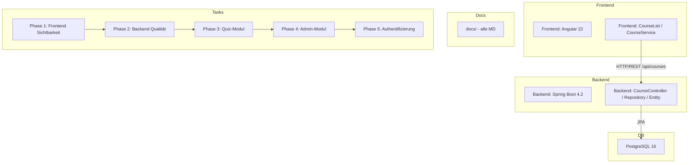

# 🗂️ Lernportal – Projekt-Übersicht

## 🎯 Kurzbeschreibung

Fullstack-Lernportal: **Angular 22 (Standalone + SSR)** + **Spring Boot 4.2.0 (Gradle Kotlin DSL, Java 25)** + **PostgreSQL 16**.

---

## 🧱 Tech-Stack

| Schicht | Technologie |
|---------|-------------|
| Frontend | Angular 22.3.0 (Standalone Components, `@angular/ssr`, Vitest) |
| Backend | Spring Boot 4.2.0, Spring Data JPA, PostgreSQL Driver, Lombok, Validation |
| DB | PostgreSQL 16 (`learning_dashboard`, User `learning_user`) |
| API | REST unter `/api/courses` (GET/POST/PUT/DELETE) |
| CORS | `http://localhost:4200` → `/api/**` erlaubt |
| Build | Gradle Kotlin DSL (`build.gradle.kts`) |

---

## 🗺️ Projekt-Diagramm (Mermaid)

---

## 📋 Task-Status-Tabelle

| ID | Task | Phase | Status | Detail-MD | Unit-Tests |
|----|------|-------|--------|-----------|------------|
| 1.1 | `app.html` bereinigen | Frontend | ⬜ offen | [01-FRONTEND-SICHTBARKEIT.md](./01-FRONTEND-SICHTBARKEIT.md) | – |
| 1.2 | `course-list.html` bereinern | Frontend | ⬜ offen | [01-FRONTEND-SICHTBARKEIT.md](./01-FRONTEND-SICHTBARKEIT.md) | ja |
| 1.3 | Loading/Error-State | Frontend | ⬜ offen | [01-FRONTEND-SICHTBARKEIT.md](./01-FRONTEND-SICHTBARKEIT.md) | ja |
| 2.1 | Service-Layer / DTOs | Backend | ⬜ offen | [02-BACKEND-QUALITAET.md](./02-BACKEND-QUALITAET.md) | ja |
| 2.2 | Controller-Tests | Backend | ⬜ offen | [02-BACKEND-QUALITAET.md](./02-BACKEND-QUALITAET.md) | ja |
| 3.1 | Quiz-Modul (Backend) | Quiz | ⬜ offen | [03-QUIZ-MODUL.md](./03-QUIZ-MODUL.md) | ja |
| 3.2 | Quiz-Modul (Frontend) | Quiz | ⬜ offen | [03-QUIZ-MODUL.md](./03-QUIZ-MODUL.md) | ja |
| 4.1 | Admin-Modul | Admin | ⬜ offen | [04-ADMIN-MODUL.md](./04-ADMIN-MODUL.md) | ja |
| 5.1 | Authentifizierung (JWT) | Auth | ⬜ offen | [05-AUTHENTIFIZIERUNG.md](./05-AUTHENTIFIZIERUNG.md) | ja |

**Legende:** ⬜ offen · 🟡 in Arbeit · ✅ erledigt

---

## 📌 Hinweise

- **Docker:** bewusst vorerst ignoriert (siehe Plan Phase 4).
- **Unit-Tests** werden in fast jedem Detail-MD vorgegeben; die Kreuzübersicht liegt in `99-TEST-STRATEGIE.md`.
- Jeder Task ist erst **erledigt**, wenn Code + Unit-Tests grün sind.

---

## 📑 Dokumentations-Index

| MD | Inhalt |
|----|--------|
| `00-UEBERSICHT.md` | Dieses Dashboard (Diagramm + Status-Tabelle) |
| `01-FRONTEND-SICHTBARKEIT.md` | Phase 1: `app.html` bereinigen, Loading/Error |
| `02-BACKEND-QUALITAET.md` | Phase 2: Service-Layer, DTOs, Controller-Tests |
| `03-QUIZ-MODUL.md` | Phase 3: Question/Answer Backend + Quiz-Frontend |
| `04-ADMIN-MODUL.md` | Phase 4: Admin-CRUD-Oberfläche |
| `05-AUTHENTIFIZIERUNG.md` | Phase 5: Spring Security + JWT |
| `99-TEST-STRATEGIE.md` | Cross-Cutting: Test-Frameworks, Regeln, DoD |

---

## ➡️ Nächster Schritt

- [ ] `01-FRONTEND-SICHTBARKEIT.md` umsetzen (Task 1.1–1.3)
- [ ] Danach Status in dieser Übersicht auf 🟡 / ✅ setzen
- [ ] Danach Phase 2 … bis Phase 5
