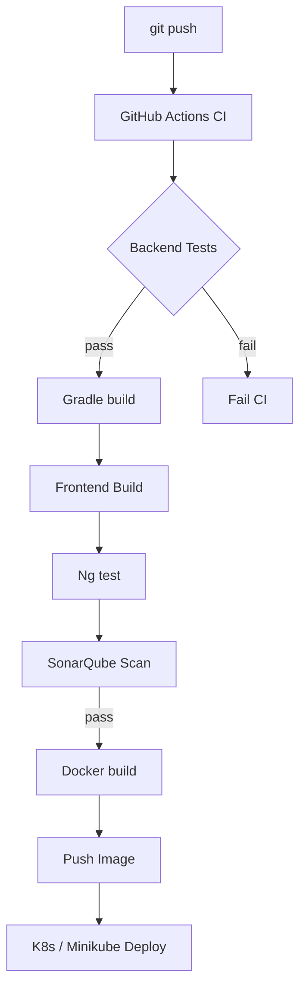
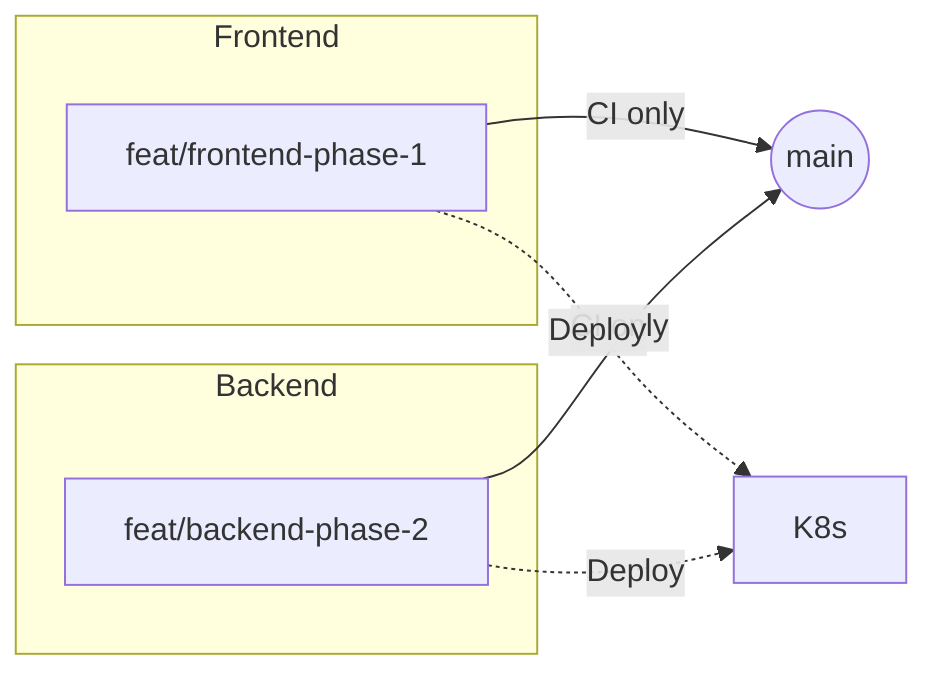

# Deployment & CI/CD Recommendation Plan

## 🎯 Goal
Build, test, analyze code quality (SonarQube), containerize, and deploy frontend + backend in a reproducible pipeline — mimicking how other projects operate.

---

## 📋 High-Level Flow



---

## 🛠️ Tool Stack

| Layer | Tool | Role |
|-------|------|------|
| Source Control | Git (GitHub) | Repo, branches |
| CI (Code Tests) | GitHub Actions | Run tests on PR/push |
| CI (Quality) | SonarQube | Static analysis, quality gates |
| Build | Gradle (Backend), npm (Frontend) | Compile |
| Containerization | Docker | Images for each service |
| Orchestration | Minikube / K8s | Deploy containers |
| Scheduling/Orchestration | Jenkins | Optional production deployment |

---

## 🚀 Recommended Phases

### Phase 1 – CI (GitHub Actions) *(already configured)*
- Triggers on push/PR to `main`, `feat/*`
- Runs `./gradlew test` (backend) and `ng test` (frontend)
- Ready to extend later.

### Phase 2 – Jenkins + Docker (Production)
- Install Jenkins on a host.
- Use `jenkins/jenkins:lts` inside **Docker Compose**.
- Add stages:
  1. Checkout
  2. Build & Test Backend
  3. Build & Test Frontend
  4. SonarQube Scan (quality gate)
  5. Docker Build (both services)
  6. Push images to registry
  7. Deploy to Minikube (dev) or K8s (prod)

**Docker Compose example** (`docker-compose.jenkins.yml`):

```yaml
version: '3.8'
services:
  jenkins:
    image: jenkins/jenkins:lts
  sonarqube:
    image: sonarsource/sonar-qml:latest
  postgres:
    image: postgres:16
  docker:
    image: docker:27-dind
  backend:
    build: .
    ports: ['8080:8080']
  frontend:
    build: .
    ports: ['4200:80']
volumes:
  postgres_data:
```

### Phase 3 – Deployment
- Build Docker images tagged with commit SHA.
- Push to Docker Hub / GHCR.
- Apply manifests to Minikube/K8s:
  - `deployment-backend.yaml`
  - `deployment-frontend.yaml`
  - `service-backend.yaml`
  - `service-frontend.yaml`

---

## 🖼️ Visual Diagrams

### 1. End-to-End Pipeline (Mermaid)


### 2. Branch Strategy



---

## ✅ Quick Start Checklist

- [ ] Create feature branches `feat/frontend-phase-X` & `feat/backend-phase-Y`.
- [ ] Commit changes, run local tests (`ng test`, `./gradlew test`).
- [ ] Push branch → GitHub Actions runs automatically.
- [ ] Open PR → Code Review → Merge to `main`.
- [ ] Trigger Jenkins (or let GitHub Actions notify).
- [ ] Jenkins builds images, pushes, deploys.

---

## 📚 References

- Existing docs: `00-UEBERSICHT.md`, `01-FRONTEND-SICHTBARKEIT.md`, etc.
- CI workflow: `.github/workflows/ci.yml`
- Jenkinsfile: *(to be created)*
- Dockerfiles: `lernportal-backend/Dockerfile`, `lernportal-frontend/Dockerfile`

---

*Generated by Cline*
