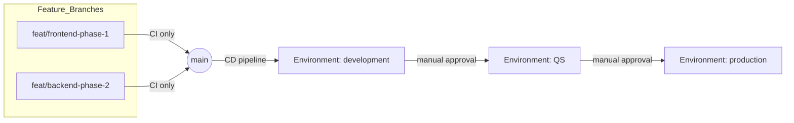

# Deployment & CI/CD Recommendation Plan

## 🎯 Goal
Build, test, analyze code quality (SonarQube), containerize, and deploy frontend + backend in a reproducible pipeline — mimicking how other projects operate.

---

## 📋 High-Level Flow

```mermaid
flowchart TD
    %% PR Trigger
    A[git push to feat/* branch] --> B[Open Pull Request]
    B --> C[GitHub Actions CI (on: pull_request)]
    C -->|Tests run| D{Backend Tests}
    D -- pass --> E[Merge PR to main]
    D -- fail --> F[Keep branch open / fix issues]

    %% Push to main Trigger
    E --> G[Git push to main]
    G --> H[GitHub Actions CD (on: push to main)]
    H --> I[Backend Tests + Build]
    J[Frontend Tests + Build] --> I
    I -- pass --> K[SonarQube Scan]
    K -- pass --> L[Docker Build (Backend + Frontend)]
    L --> M[Push Images to Docker Hub]
    M --> N[Deploy to Dev (auto)]
    N --> O{Manual Approval?}
    O -- yes --> P[Deploy to Prod]
    O -- no --> Q[Stop at Dev]

    style A fill:#e1f5fe,stroke:#01579b,stroke-width:2px
    style C fill:#e8f5e9,stroke:#2e7d32,stroke-width:2px
    style H fill:#fff3e0,stroke:#ef6c00,stroke-width:2px
    style N fill:#e3f2fd,stroke:#1976d2,stroke-width:2px
    style P fill:#f3e5f5,stroke:#8e24aa,stroke-width:2px
```

---

## 🛠️ Tool Stack

| Layer | Tool | Role |
|-------|------|------|
| **Source Control** | Git (GitHub) | Repo, branches |
| **CI / CD** | GitHub Actions | Run tests, build, scan, deploy on PR/push |
| **Code Quality** | SonarQube (self-hosted, Docker Compose) | Static analysis, quality gates |
| **Build** | Gradle (Backend), npm (Frontend) | Compile, test, package |
| **Containerization** | Docker | Images for each service |
| **Registry** | Docker Hub | Store Docker images |
| **Orchestration** | Minikube (local) | Deploy containers |
| **Deploy Method** | kubectl / Helm / ArgoCD (learning all three) | Apply manifests to cluster |
| **Runner** | **Self-hosted Runner (local)** | Access to local SonarQube + Minikube |

> **Architecture Decision:** Everything runs **locally** (SonarQube in Docker Compose + Minikube on your machine). GitHub-hosted runners cannot reach localhost → **Self-hosted Runner required** on your machine.

---

## 🏗️ Local Infrastructure Setup

### Self-Hosted Runner (on your machine)

The self-hosted runner executes workflow jobs and has direct network access to:
- `http://localhost:9000` (SonarQube)
- Minikube Kubernetes API (via `minikube tunnel` or `kubectl` with local kubeconfig)

**Setup steps:**
```bash
# 1. Create runner directory
mkdir -p ~/actions-runner && cd ~/actions-runner

# 2. Download latest runner (Linux x64)
curl -o actions-runner-linux-x64-2.317.0.tar.gz -L \
  https://github.com/actions/runner/releases/download/v2.317.0/actions-runner-linux-x64-2.317.0.tar.gz
tar xzf actions-runner-linux-x64-2.317.0.tar.gz

# 3. Configure runner (get token from GitHub repo Settings → Actions → Runners)
./config.sh --url https://github.com/<OWNER>/<REPO> --token <RUNNER_TOKEN> \
  --name local-runner --labels self-hosted,local,docker,k8s,sonarqube

# 4. Run as service (recommended) or interactive
sudo ./svc.sh install
sudo ./svc.sh start
# OR interactive: ./run.sh
```

**Required tools on runner machine:**
- Docker & Docker Compose
- kubectl + minikube
- Java 21+ (for Gradle)
- Node.js 20+ (for Angular)
- Gradle wrapper (in repo)

### SonarQube (Docker Compose)

```yaml
# docker-compose.sonarqube.yml
version: '3.8'
services:
  sonarqube:
    image: sonarqube:10.5-community
    container_name: sonarqube
    ports:
      - "9000:9000"
    environment:
      - SONAR_JDBC_URL=jdbc:postgresql://postgres:5432/sonar
      - SONAR_JDBC_USERNAME=sonar
      - SONAR_JDBC_PASSWORD=sonar
    volumes:
      - sonarqube_data:/opt/sonarqube/data
      - sonarqube_extensions:/opt/sonarqube/extensions
      - sonarqube_logs:/opt/sonarqube/logs
    depends_on:
      - postgres
    networks:
      - sonarqube_net

  postgres:
    image: postgres:16
    container_name: sonarqube-postgres
    environment:
      - POSTGRES_USER=sonar
      - POSTGRES_PASSWORD=sonar
      - POSTGRES_DB=sonar
    volumes:
      - postgres_data:/var/lib/postgresql/data
    networks:
      - sonarqube_net

volumes:
  sonarqube_data:
  sonarqube_extensions:
  sonarqube_logs:
  postgres_data:

networks:
  sonarqube_net:
```

Start: `docker compose -f docker-compose.sonarqube.yml up -d`

### Minikube

```bash
# Start Minikube with Docker driver (recommended for local)
minikube start --driver=docker --cpus=4 --memory=8192

# Enable ingress (optional)
minikube addons enable ingress

# For LoadBalancer services (optional)
minikube tunnel  # run in separate terminal
```

---

## 🚀 Recommended Phases

### Phase 1 – CI (GitHub Actions) *(already configured)*
- Triggers on **push** to `main`, `feat/*` **and** on **pull_request** to `main`
- Runs on **self-hosted runner** (label: `self-hosted`)
- Runs `./gradlew test` (backend) and `ng test` (frontend)
- On PR: Tests run **before merge**, ensuring code quality
- On push to main: Triggers CD pipeline

### Phase 2 – CD (GitHub Actions) *(replaces Jenkins)*
The entire pipeline runs in GitHub Actions workflows on the **self-hosted runner**.

```mermaid
flowchart TD
    A[push to main] --> B[Checkout]
    B --> C[Setup Java + Node]
    C --> D[Backend: gradlew test + build]
    C --> E[Frontend: npm ci + ng test + ng build]
    D --> F[SonarQube Scan]
    E --> F
    F -- quality gate pass --> G[Docker Build (backend + frontend)]
    G --> H[Push Images to Docker Hub]
    H --> I[Deploy to Dev (auto)]
    I --> J{Environment: production?}
    J -- manual approval --> K[Deploy to Prod]
```

**Jobs (run on `runs-on: [self-hosted, local]`):**

| Job | Needs | Key Actions |
|-----|-------|-------------|
| `backend` | – | Checkout, setup-java, `./gradlew test build` |
| `frontend` | – | Checkout, setup-node, `npm ci`, `ng test`, `ng build` |
| `sonarqube` | backend, frontend | `SonarSource/sonarqube-scan-action` (points to `http://localhost:9000`) |
| `docker` | sonarqube | `docker/build-push-action` → Docker Hub |
| `deploy-dev-kubectl` | docker | `kubectl apply -k k8s/overlays/dev` |
| `deploy-dev-helm` | docker | `helm upgrade --install ...` |
| `deploy-dev-argocd` | docker | ArgoCD app sync (if ArgoCD installed) |
| `deploy-prod-*` | deploy-dev-* | **Environment: production** + required reviewers |

> **Three Deploy Variants (learning):**
> - `deploy-kubectl.yml` – Direct `kubectl apply` with Kustomize
> - `deploy-helm.yml` – Helm charts with values files
> - `deploy-argocd.yml` – ArgoCD Application sync (GitOps pull model)

### Phase 3 – Deployment Manifests
- Build Docker images tagged with commit SHA + `latest`.
- Push to Docker Hub (`docker.io/<username>/<repo>-backend:sha`).
- Apply manifests to Minikube:
  - Kustomize structure:
    ```
    k8s/
      base/
        deployment-backend.yaml
        deployment-frontend.yaml
        service-backend.yaml
        service-frontend.yaml
        kustomization.yaml
      overlays/
        dev/
          kustomization.yaml
        prod/
          kustomization.yaml
    ```
  - Helm charts: `helm/backend/`, `helm/frontend/`
  - ArgoCD: `argocd/applications.yaml`

---

## 🖼️ Visual Diagrams

### 1. Complete Pipeline (Mermaid) – PR & Push Flow

```mermaid
flowchart TD
    %% Pull Request Path
    A[git push to feat/*] --> B[Open Pull Request]
    B --> C[GitHub Actions CI (on: pull_request, self-hosted)]
    C --> D{Backend Tests}
    E[Frontend Tests] --> D
    D -- pass --> F[Merge PR into main]
    D -- fail --> G[Fix issues in branch]

    %% Push to main Path (CD)
    F --> H[git push to main]
    H --> I[GitHub Actions CD (on: push to main, self-hosted)]
    I --> J[Backend Tests + Build]
    K[Frontend Tests + Build] --> J
    J -- pass --> L[SonarQube Scan (localhost:9000)]
    L -- quality gate pass --> M[Docker Build + Push (Docker Hub)]
    M --> N[Deploy to Dev (auto)]
    N --> O{Manual Approval?}
    O -- yes --> P[Deploy to Prod]
    O -- no --> Q[Done at Dev]

    style A fill:#e1f5fe,stroke:#01579b,stroke-width:2px
    style C fill:#e8f5e9,stroke:#2e7d32,stroke-width:2px
    style I fill:#fff3e0,stroke:#ef6c00,stroke-width:2px
    style N fill:#e3f2fd,stroke:#1976d2,stroke-width:2px
    style P fill:#f3e5f5,stroke:#8e24aa,stroke-width:2px
```

### 2. Branch Strategy with Environments



### 3. Self-Hosted Runner Architecture

```mermaid
flowchart LR
    GH[GitHub Actions] -->|dispatch job| Runner[Self-Hosted Runner\n(local machine)]
    Runner -->|localhost:9000| SQ[SonarQube\nDocker Compose]
    Runner -->|kubectl| MK[Minikube\nKubernetes API]
    Runner -->|docker push| DH[Docker Hub]
    Runner -->|gradle/npm| Build[Build Tools]
```

---

## ✅ Quick Start Checklist

- [ ] **Local Infrastructure:**
  - [ ] Start SonarQube: `docker compose -f docker-compose.sonarqube.yml up -d`
  - [ ] Start Minikube: `minikube start --driver=docker`
  - [ ] Install & configure self-hosted runner (see setup steps above)
- [ ] **GitHub Secrets** (Repository Settings → Secrets → Actions):
  - `SONAR_TOKEN` – SonarQube user token
  - `SONAR_HOST_URL` – `http://localhost:9000` (for self-hosted runner)
  - `DOCKERHUB_USERNAME` – Docker Hub username
  - `DOCKERHUB_TOKEN` – Docker Hub access token
  - `KUBECONFIG` – Base64-encoded kubeconfig (optional, if not using runner's local config)
- [ ] **GitHub Environments** (Settings → Environments):
  - `development` – no reviewers (auto-deploy)
  - `QS` – required reviewers: you/team
  - `production` – required reviewers: you/team
- [ ] Create feature branches `feat/frontend-phase-X` & `feat/backend-phase-Y`.
- [ ] Commit changes, run local tests (`ng test`, `./gradlew test`).
- [ ] Push branch → GitHub Actions runs automatically (**on push**, self-hosted).
- [ ] Open PR → GitHub Actions runs (**on pull_request**) → Code Review → Merge to `main`.
- [ ] After merge, push to `main` triggers **CD pipeline**:
  - [ ] Tests + Build
  - [ ] SonarQube quality gate
  - [ ] Docker build & push to Docker Hub
  - [ ] Auto-deploy to **Dev** environment (kubectl/Helm/ArgoCD)
  - [ ] Manual approval in **QS** → Deploy to QS
  - [ ] Manual approval in **Production** → Deploy to Prod
- [ ] Verify Docker images in Docker Hub and pods running in Minikube.

---

## 📚 References

- Existing docs: `00-UEBERSICHT.md`, `01-FRONTEND-SICHTBARKEIT.md`, etc.
- CI/CD workflows:
  - `.github/workflows/ci.yml` – backend + frontend tests on self-hosted runner
  - `.github/workflows/cd-kubectl.yml` – docker build/push + deploy (Kustomize, dev/prod)
  - `.github/workflows/cd-helm.yml` – docker build/push + deploy (Helm, dev/prod)
  - `.github/workflows/cd-argocd.yml` – docker build/push + ArgoCD sync (dev/prod)
- Local infra:
  - `docker-compose.sonarqube.yml`
  - `sonar-project.properties`
  - Minikube setup
- Dockerfiles: `lernportal-backend/Dockerfile`, `lernportal-frontend/Dockerfile`
- K8s manifests: `k8s/` (Kustomize structure)
- Helm charts: `helm/backend/`, `helm/frontend/`
- Self-hosted runner setup: [GitHub Docs](https://docs.github.com/en/actions/hosting-your-own-runners)

---

## ✅ Decisions Made (no open questions)

1. **SonarQube**: Self-hosted in Docker Compose on local machine → `http://localhost:9000`
2. **Docker Registry**: Docker Hub
3. **Deploy Methods**: All three (kubectl/Kustomize, Helm, ArgoCD) – separate workflows for learning
4. **K8s Access**: Self-hosted runner with local `kubectl` + Minikube config
5. **Environments**: `development` (auto), `QS` (manual), `production` (manual) with user reviewers
6. **Runner**: Self-hosted on local machine (labels: `self-hosted`, `local`, `docker`, `k8s`, `sonarqube`)

*Generated by Cline*