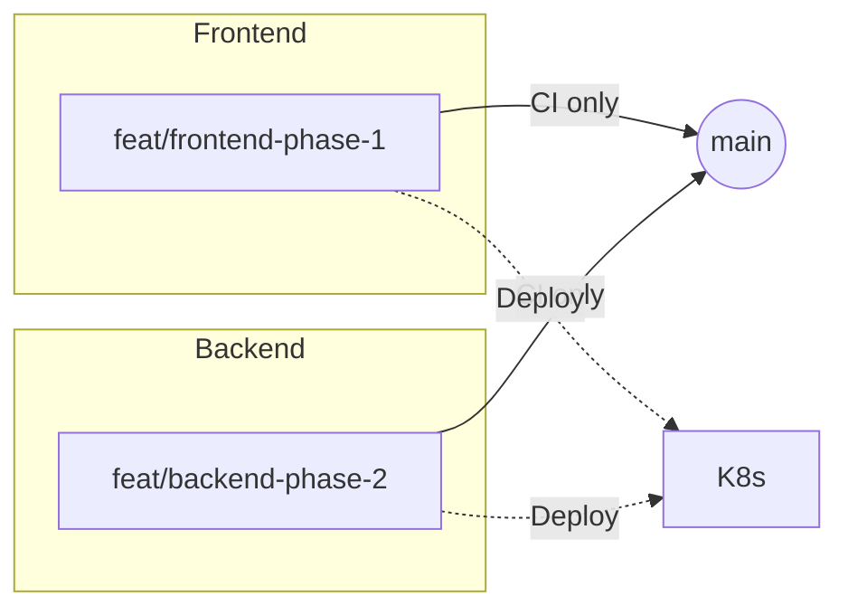
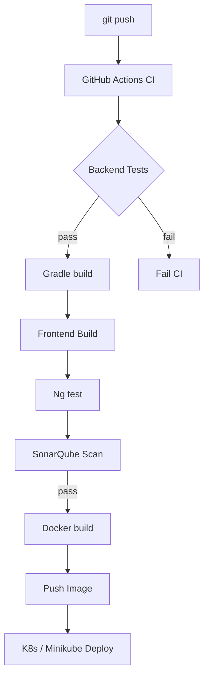

# Deployment & CI/CD Recommendation Plan

## 🎯 Goal
Build, test, analyze code quality (SonarQube), containerize, and deploy frontend + backend in a reproducible pipeline — mimicking how other projects operate.

---

## 📋 High-Level Flow

```mermaid
flowchart TD
    %% PR Trigger
    A[git push to feat/* branch] --> B[Open Pull Request]
    B --> C[GitHub Actions CI (on: pull_request)]
    C -->|Tests run| D{Backend Tests}
    D -- pass --> E[Merge PR to main]
    D -- fail --> F[Keep branch open / fix issues]

    %% Push to main Trigger
    E --> G[Git push to main]
    G --> H[GitHub Actions CI (on: push to main)]
    H --> I[Backend Tests]
    I --> J[Gradle build]
    J --> K[Frontend Build]
    K --> L[Ng test]
    L --> M[SonarQube Scan]
    M -- pass --> N[Docker build]
    N --> O[Push Image]
    O --> P[K8s / Minikube Deploy]

    %% Direct push path (optional)
    G -->|if push directly| H

    style A fill:#e1f5fe,stroke:#01579b,stroke-width:2px
    style C fill:#e8f5e9,stroke:#2e7d32,stroke-width:2px
    style H fill:#fff3e0,stroke:#ef6c00,stroke-width:2px
    style P fill:#f3e5f5,stroke:#8e24aa,stroke-width:2px
```

---

## 🛠️ Tool Stack

| Layer | Tool | Role |
|-------|------|------|
| **Source Control** | Git (GitHub) | Repo, branches |
| **CI (Code Tests)** | GitHub Actions | Run tests on PR/push |
| **CI (Quality)** | SonarQube | Static analysis, quality gates |
| **Build** | Gradle (Backend), npm (Frontend) | Compile |
| **Containerization** | Docker | Images for each service |
| **Orchestration** | Minikube / K8s | Deploy containers |
| **Scheduling/Orchestration** | Jenkins | Optional production deployment |

---

## 🚀 Recommended Phases

### Phase 1 – CI (GitHub Actions) *(already configured)*
- Triggers on **push** to `main`, `feat/*` **and** on **pull_request** to `main`
- Runs `./gradlew test` (backend) and `ng test` (frontend)
- On PR: Tests run **before merge**, ensuring code quality
- On push to main: Triggers deployment pipeline

### Phase 2 – Jenkins + Docker (Production)
- Install Jenkins on a host.
- Use `jenkins/jenkins:lts` inside **Docker Compose**.
- Add stages:
  1. Checkout
  2. Build & Test Backend
  3. Build & Test Frontend
  4. SonarQube Scan (quality gate)
  5. Docker Build (both services)
  6. Push images to registry
  7. Deploy to Minikube (dev) or K8s (prod)

**Docker Compose example** (`docker-compose.jenkins.yml`):

```yaml
version: '3.8'
services:
  jenkins:
    image: jenkins/jenkins:lts
  sonarqube:
    image: sonarsource/sonar-qml:latest
  postgres:
    image: postgres:16
  docker:
    image: docker:27-dind
  backend:
    build: .
    ports: ['8080:8080']
  frontend:
    build: .
    ports: ['4200:80']
volumes:
  postgres_data:
```

### Phase 3 – Deployment
- Build Docker images tagged with commit SHA.
- Push to Docker Hub / GHCR.
- Apply manifests to Minikube/K8s:
  - `deployment-backend.yaml`
  - `deployment-frontend.yaml`
  - `service-backend.yaml`
  - `service-frontend.yaml`

---

## 🖼️ Visual Diagrams

### 1. Complete Pipeline (Mermaid) – PR & Push Flow

```mermaid
flowchart TD
    %% Pull Request Path
    A[git push to feat/*] --> B[Open Pull Request]
    B --> C[GitHub Actions CI (on: pull_request)]
    C --> D{Backend Tests}
    E[Frontend Tests] --> D
    D -- pass --> F[Merge PR into main]
    D -- fail --> G[Fix issues in branch]

    %% Push to main Path
    F --> H[git push to main]
    H --> I[GitHub Actions CI (on: push to main)]
    I --> J[Backend Tests]
    K[Frontend Tests] --> J
    J -- pass --> L[Gradle build]
    L --> M[Frontend Build]
    M --> N[Ng test]
    O[SonarQube Scan] --> N
    N -- pass --> P[Docker build]
    P --> Q[Push Image]
    Q --> R[K8s / Minikube Deploy]

    style A fill:#e1f5fe,stroke:#01579b,stroke-width:2px
    style C fill:#e8f5e9,stroke:#2e7d32,stroke-width:2px
    style I fill:#fff3e0,stroke:#ef6c00,stroke-width:2px
    style R fill:#f3e5f5,stroke:#8e24aa,stroke-width:2px
```

### 2. Branch Strategy



### 3. End-to-End Pipeline (Simplified)



---

## ✅ Quick Start Checklist

- [ ] Create feature branches `feat/frontend-phase-X` & `feat/backend-phase-Y`.
- [ ] Commit changes, run local tests (`ng test`, `./gradlew test`).
- [ ] Push branch → GitHub Actions runs automatically (**on push**).
- [ ] Open PR → GitHub Actions runs (**on pull_request**) → Code Review → Merge to `main`.
- [ ] After merge, push to `main` triggers deployment pipeline.
- [ ] Verify Docker images built and deployed to K8s/Minikube.

---

## 📚 References

- Existing docs: `00-UEBERSICHT.md`, `01-FRONTEND-SICHTBARKEIT.md`, etc.
- CI workflow: `.github/workflows/ci.yml`
- Jenkinsfile: *(to be created)*
- Dockerfiles: `lernportal-backend/Dockerfile`, `lernportal-frontend/Dockerfile`

*Generated by Cline*